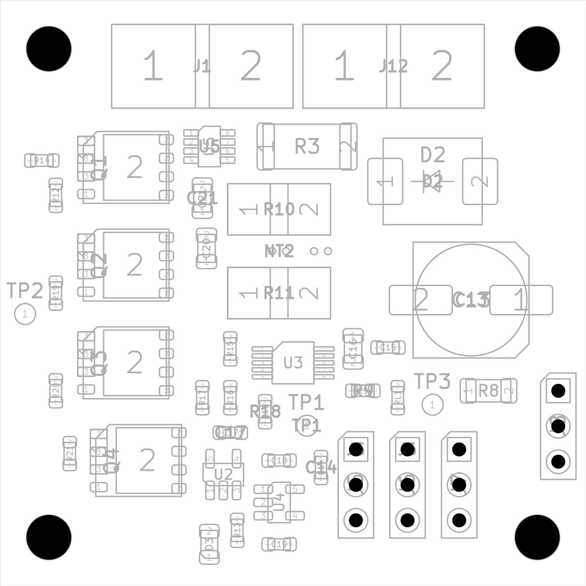

# Power Distribution Board

Four-layer, 42 x 42 mm power distribution board for a 4S2P Li-ion system. The design combines a high-current ESC supply path, reverse-polarity protection, 5 V and 12 V auxiliary power interfaces, and analog/digital power telemetry.

> [!CAUTION]
> **This project is not fabrication-ready, and 50 A is a design target—not a tested current rating.** The current revision requires a non-standard mixed-copper stackup that has not been accepted by a fabricator. Thermal performance, current sharing, fuse coordination, wiring, BEC selection, and full-load operation also remain unqualified. Do not order boards or connect a high-current battery without completing the open release gates.



## Current design

The authoritative revision is in [`engineering/release50`](engineering/release50/):

- [`PDB_50A.kicad_pro`](engineering/release50/PDB_50A.kicad_pro) — KiCad project
- [`PDB_50A.kicad_sch`](engineering/release50/PDB_50A.kicad_sch) — schematic
- [`PDB_50A.kicad_pcb`](engineering/release50/PDB_50A.kicad_pcb) — PCB layout
- [`PDB_50A.kicad_dru`](engineering/release50/PDB_50A.kicad_dru) — design rules
- [`CONTINUATION.md`](engineering/release50/CONTINUATION.md) — latest engineering status and revision history
- [`fabrication_20260915/MANUFACTURING_SPEC.md`](engineering/release50/fabrication_20260915/MANUFACTURING_SPEC.md) — current vendor-neutral manufacturing requirements
- [`PDB_50A_DESIGN_RECORD.md`](engineering/release50/PDB_50A_DESIGN_RECORD.md) — detailed design record, interfaces, BOM review, and release gates

The root-level `Swayatt_PCB*` files and `engineering/release42` are earlier development revisions and are retained for traceability.

## Design summary

| Item | Current design |
| --- | --- |
| Board | 42 x 42 mm, nominal 1.6 mm, four copper layers |
| Battery | 4S2P Li-ion; 14.8 V nominal, 16.8 V maximum normal |
| Load target | 50 A aggregate, unqualified |
| Stackup | 1 oz outer / 2 oz inner copper; vendor acceptance required |
| Main protection | External fuse provision and LM74502-controlled parallel NMOS reverse-polarity stage |
| Main output | ESC battery interface |
| Auxiliary power | External 5 V and 12 V BEC interfaces; outputs must not be paralleled |
| Telemetry | INA169 analog current sensing and INA228 digital power monitoring |
| CAD format | KiCad 10.0 |

## Verification snapshot

The active September 15, 2026 revision records:

- zero ERC findings and zero unconnected items;
- zero DRC findings under the included 6 mil / 5 mil mixed-copper rule deck;
- 52 electrical invariants and nine additional checks passing;
- matching PCB/netlist pad assignments and verified manufacturing exports.

These checks establish internal design consistency only. They do **not** establish manufacturability, thermal safety, a 50 A rating, or production readiness. See [`verification.json`](engineering/release50/verification.json) and the latest status in [`CONTINUATION.md`](engineering/release50/CONTINUATION.md).

## Opening the project

1. Install KiCad 10.0 or a compatible newer version.
2. Clone this repository.
3. Open `engineering/release50/PDB_50A.kicad_pro`.
4. Keep the repository structure intact so the included symbol and footprint library tables resolve correctly.

Before modifying or exporting the board, read the latest continuation notes and manufacturing specification. Generated review packages are evidence artifacts, not approved fabrication releases.

## Repository layout

```text
engineering/release50/   Active 50 A-target design, checks, and review outputs
engineering/release42/   Previous 42 mm development revision
engineering/             Analysis, routing, rendering, and verification scripts
Swayatt_Local.pretty/    Project-specific KiCad footprints
Swayatt_Local.kicad_sym  Project-specific KiCad symbols
```

## License

Licensed under the [Apache License 2.0](LICENSE).
